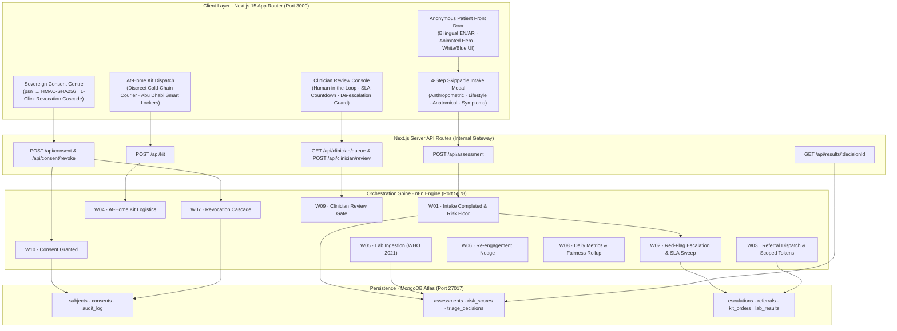
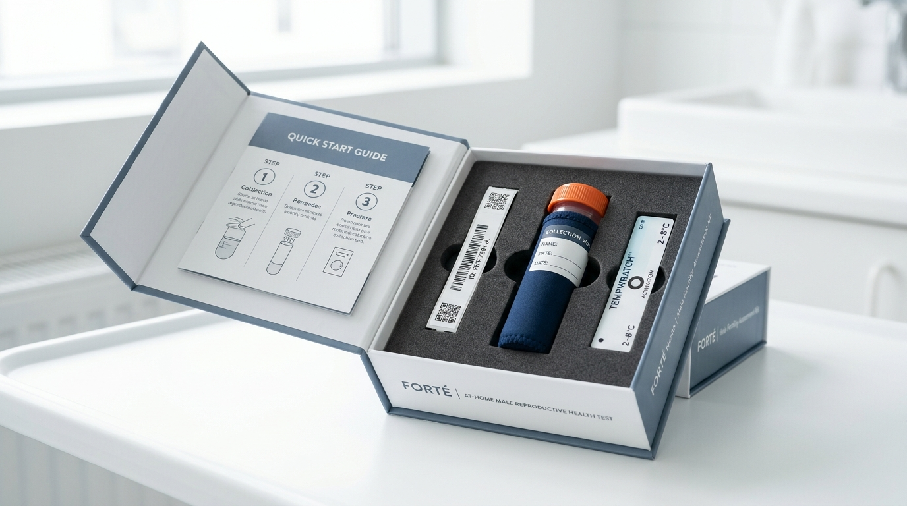

<div align="center">

# 🩺 VIGOR · صـحـة
### **A Confidential, Anonymous-First Front Door for Male Reproductive Health**

[](https://nextjs.org/)
[](https://www.typescriptlang.org/)
[](https://tailwindcss.com/)
[](https://n8n.io/)
[](https://www.mongodb.com/)
[](https://www.docker.com/)
[](docs/06-clinical-safety.md)
[](tools/smoke/run-smoke.js)

<p align="center">
  <b>Developed for the Abu Dhabi Male Reproductive Health Challenge</b><br>
  Early, explainable risk identification · Deterministic safety floors · WHO 2021 6th Edition Semen Standards · Sovereign Cryptographic Consent Ledger
</p>

[Explore Web Portal](http://localhost:3000) · [n8n Workflow Engine](http://localhost:5678) · [Architecture & Spec](docs/01-architecture.md) · [Clinical Safety Invariants](docs/06-clinical-safety.md)

---

</div>

## 💡 The Clinical Challenge & The Vigor Paradigm

> **The Problem:** Male factors contribute to roughly **50% of all infertility cases**, yet men typically enter care only as a late-stage reaction—frequently after years of unsuccessful conception and extensive partner evaluations. By that time, reversible metabolic, lifestyle, infectious, and anatomical risk factors (such as varicoceles or untreated endocrine deficits) have gone unaddressed for years.
>
> **The Barrier:** Cultural stigma, fear of exposure, and embarrassment prevent in-person consultations during early symptom stages. Crucially, time-critical emergencies like **testicular torsion** (<6h window) require immediate intervention.
>
> **The Vigor Solution:** A culturally trusted, stigma-aware digital front door that a man can use **alone, anonymously, in Arabic or English**, with **zero account registration**. Vigor combines an interactive web portal, a **deterministic 9-flag safety floor** that no AI can override downward, and an **append-only cryptographic consent ledger** that allows instant 1-click revocation.

---

## 🏛️ System Architecture



---

## ✨ Key Platform Features

### 1. 🎨 Decent, Clinical White & Blue UI
- **Pure White Canvas (`#FFFFFF`)**: Crisp, hospital-grade typography in deep navy and royal blues (`#0A2540`, `#0066CC`).
- **Animated Healthcare Hero Visual**: Interactive SVG telemetry monitor displaying an active ECG cardiac rhythm line, 72 BPM pulsating bio-core, rotating orbital telemetry rings, and floating status cards.
- **Bilingual & RTL-First**: 1-click switch between **English** and **العربية** with native right-to-left typography, respectful cultural terminology, and contextual translations.

### 2. 🛡️ Deterministic Safety Floor (The 9 Red-Flag Gates)
Pure, non-AI mathematical evaluation over a closed symptom vocabulary that strictly enforces the **Escalate-Only Invariant**:

| Flag Code | Clinical Presentation | Triaged Acuity | Action SLA |
| :--- | :--- | :--- | :--- |
| `RF_ACUTE_SCROTAL_PAIN` | Sudden severe testicular pain (<6h) | **URGENT** (Torsion risk) | **Immediate / 60 min** |
| `RF_TESTICULAR_MASS` | Painless hard lump in testis | **URGENT** (Malignancy suspicion) | **Same Day / 4 hours** |
| `RF_PRIAPISM` | Sustained painful erection (>4h) | **URGENT** (Ischaemia risk) | **Immediate / 60 min** |
| `RF_GU_TRAUMA` | Significant straddle or testicular trauma | **URGENT** (Rupture / haematoma) | **Immediate / 60 min** |
| `RF_ACUTE_URINARY_RETENTION`| Complete inability to pass urine | **URGENT** (Bladder injury risk) | **Immediate / 60 min** |
| `RF_FEBRILE_GU_INFECTION` | High fever + urethral discharge / dysuria | **URGENT** (Epididymo-orchitis) | **4 hours** |
| `RF_PITUITARY_SUSPICION` | Peripheral visual field deficit + gynaecomastia | **ANDROLOGY_UROLOGY** | **24 hours** |
| `RF_BILATERAL_UNDESCENDED` | Uncorrected bilateral cryptorchidism | **ANDROLOGY_UROLOGY** | **72 hours** |
| `RF_ABSENT_VAS` | Congenital bilateral absence of vas deferens | **ANDROLOGY_UROLOGY** | **72 hours** |

> **Non-Diagnostic Boundary Payload:** Every assessment payload includes an unalterable programmatic disclaimer stating: *`isDiagnosis: false`*, with mandatory referral to licensed Department of Health (DoH) practitioners.

### 3. 🔬 WHO 2021 6th Edition Semen Analysis Simulator
Interactive diagnostic calculator evaluating semen parameters against the global 5th percentile lower reference limits:
- **Volume:** $\ge 1.4\text{ mL}$
- **Concentration:** $\ge 16\times 10^6\text{ /mL}$
- **Total Count:** $\ge 39\times 10^6\text{ /ejaculate}$
- **Progressive Motility ($PR$):** $\ge 30\%$
- **Total Motility ($PR+NP$):** $\ge 42\%$
- **Normal Forms (Morphology):** $\ge 4\%$
- **Vitality:** $\ge 54\%$
- **Severe Result Gate:** Detections of **Azoospermia** withhold numerical figures from automated patient communications to prevent psychological distress, immediately routing to private clinical review.

### 4. 🔐 Sovereign Privacy Ledger & Revocation Cascade
- **Zero Account Requirement:** Users receive a salted HMAC-SHA256 pseudonym identifier (`psn_...`). No names, emails, or civil IDs stored in clinical tables.
- **Append-Only Consent Ledger:** Scoped access (`ASSESSMENT`, `STORE_RESULTS`, `SHARE_WITH_CLINICIAN`, `AT_HOME_TESTING`).
- **1-Click Cryptographic Revocation:** Triggering revocation executes **Workflow 07**, which invalidates active referral share tokens, halts follow-up SMS/WhatsApp notifications, purges cached data, and returns a tamper-proof SHA-256 revocation receipt.

---

## 📸 Clinical Infrastructure & Care Delivery Gallery

The platform features high-resolution clinical photography documenting authentic Abu Dhabi care pathways:

<div align="center">
  <table>
    <tr>
      <td width="50%">
        
        <p align="center"><b>Modern CASA Andrology Laboratory</b><br><i>Phase-contrast microscopy for WHO 2021 semen analysis</i></p>
      </td>
      <td width="50%">
        
        <p align="center"><b>Confidential Specialist Consultation</b><br><i>Private consultations in licensed Abu Dhabi clinical suites</i></p>
      </td>
    </tr>
    <tr>
      <td width="50%">
        
        <p align="center"><b>Discreet At-Home Specimen Kit</b><br><i>Thermal-insulated preservation & smart locker collection</i></p>
      </td>
      <td width="50%">
        
        <p align="center"><b>High-Power Phase Contrast Diagnostics</b><br><i>CASA computerized sperm motility tracking & morphology</i></p>
      </td>
    </tr>
  </table>
</div>

---

## ⚡ The 10 n8n Workflows

All workflows are built from reviewable TypeScript/ESM sources in `n8n/src/` and validated against JSON Schemas:

| ID | Workflow Name | Trigger Mechanism | Functional Responsibility |
| :---: | :--- | :--- | :--- |
| **`vigor01`** | **Intake Completed → Risk & Triage** | `POST /webhook/vigor/intake-completed` | Consent check, 9 red-flag gates, escalate-only reconciliation, acuity tiering |
| **`vigor02`** | **Red-flag Escalation & SLA Sweep** | Webhook + Cron (`*/5 * * * *`) | Real-time SLA tracking, on-call paging, countdown breach alarms |
| **`vigor03`** | **Referral Dispatch & Completion** | `POST /webhook/vigor/referral-consent` | Clinician sign-off gate, facility matching, time-limited scoped share tokens |
| **`vigor04`** | **At-home Kit Logistics** | Webhook + Cron (`0 9 * * *`) | Smart locker PIN generation, cold-chain courier tracking, delivery chase |
| **`vigor05`** | **Lab Result Ingestion & Re-score** | `POST /webhook/vigor/lab-result` | WHO 2021 limits evaluation, azoospermia gate, automated re-scoring |
| **`vigor06`** | **Re-engagement Nudge** | Cron (`0 */2 * * *`) | Stigma-sensitive reminders, quiet-hours suppression, frequency caps |
| **`vigor07`** | **Consent Revocation Cascade** | `POST /webhook/vigor/consent-revoked` | Instant ledger stamp, token invalidation, reminder cancellation, SHA-256 receipt |
| **`vigor08`** | **Daily Metrics Rollup** | Cron (`30 0 * * *`) | Outcome measurements, SLA breach monitoring, demographic fairness gaps |
| **`vigor09`** | **Clinician Review Console** | `POST /webhook/vigor/clinician-review` | Human oversight sign-off, $\ge 20$-char justification check, 422 refusal for unsafe de-escalations |
| **`vigor10`** | **Consent Granted** | `POST /webhook/vigor/consent-granted` | Anonymous patient onboarding, append-only scope ledger, versioned audit logging |

---

## 🚀 Quick Start Guide

### Prerequisites
- [Docker & Docker Compose](https://www.docker.com/) (running)
- Node.js 20+ (optional on host — everything can run inside Docker)

### 1. Setup Environment
```bash
# Clone the repository
git clone https://github.com/talha963/Vigor-AI.git
cd Vigor-AI

# Create your .env file
cp .env.example .env
```

### 2. Launch Entire System (1 Command)
```bash
# Starts Next.js Web Portal (3000), n8n Engine (5678), and MongoDB (27017)
npm run stack:local
```
*(Or native Docker Compose:* `docker compose --env-file .env -f infra/docker-compose.yml --profile local-db up -d`*)*

### 3. Access Live Endpoints
- **Web Portal:** [http://localhost:3000](http://localhost:3000)
- **n8n Clinical Engine:** [http://localhost:5678](http://localhost:5678)
- **MongoDB Atlas / Local:** `localhost:27017`

---

## 🧪 Testing & Verification

The repository enforces strict deterministic safety floors:

```bash
# 1. Run 107 Offline Contract & Safety Floor Tests (No DB/Network required)
npm run verify

# 2. Reset synthetic cohort with fresh tokens
npm run docker:reset

# 3. Run 37 End-to-End Integration Smoke Tests in Docker
npm run docker:smoke

# 4. Check real-time stack health and workflow synchronization
npm run stack:status
```

### Test Suite Summary
```text
Red-flag gate (deterministic safety floor):
  pass  GC01 - Acute scrotal pain, 3 hours — possible torsion
  pass  GC02 - Painless testicular lump
  ...
  pass  GC16 - Scrotal ache with no fever (Near-miss safe)

Semen analysis flagging (WHO 2021, 6th edition):
  pass  LC01 - Azoospermia
  pass  LC02 - Severe oligozoospermia
  pass  LC03 - Mildly below reference on two parameters
  pass  LC04 - Entirely within WHO 2021 reference limits

107/107 checks passed. Safety floor verified.
37/37 docker smoke tests passed (0 failed).
```

---

## 📂 Repository Structure

```text
├── apps/
│   └── web/                     # Next.js 15 bilingual App Router portal
│       ├── public/images/       # High-resolution clinical photography
│       ├── src/
│       │   ├── app/             # App router pages & real-time API handlers
│       │   │   └── api/         # /assessment, /consent, /clinician, /kit, /results
│       │   ├── components/      # Header, Hero, Gallery, WHO Simulator, Modals
│       │   └── lib/             # Clinical rules, server session HMAC, Mongo/n8n clients
│       └── Dockerfile           # Standalone multi-stage build (0 new base images)
├── n8n/
│   ├── build.mjs                # Compiles reviewable TS/ESM sources into workflow JSON
│   ├── src/                     # Workflows w01 to w10 source code
│   └── workflows/               # Committed, reproducible workflow manifests
├── packages/
│   └── contracts/               # JSON Schema for all cross-boundary events
├── infra/
│   └── docker-compose.yml       # Production Docker stack (web + n8n + mongo)
├── tools/
│   ├── seed-cohort.js           # 240-subject synthetic cohort & 16 golden cases
│   ├── mongo-bootstrap.js       # Index creation & schema validators
│   ├── verify-contracts.js      # 107 offline safety floor assertions
│   └── smoke/run-smoke.js       # 37 end-to-end integration tests
└── docs/                        # Clinical safety, privacy, workflows, data model
```

---

## 🔒 Security & Data Sovereignty Guarantees

1. **Zero Patient Identifiers in Clinical Tables**: Sessions are keyed by an HMAC-SHA256 pseudonym salt that never leaves the server.
2. **Field-Level Encryption**: Sensitive answers and notes are encrypted with AES-256-GCM before write.
3. **Escalate-Only Clinical Clamp**: AI models and external services can only recommend higher care tiers; downgrading emergency red flags is impossible and returns HTTP 422.
4. **Data Minimization by Default**: Facility referrals receive category flags and acuity tiers—never raw intake answers or personal narratives.

---

## ⚖️ Clinical Disclaimer

*Vigor is an informational risk identification and clinical navigation platform developed for the Abu Dhabi Male Reproductive Health Challenge. It does not provide formal medical diagnoses or prescribe medical treatment. All clinical recommendations must be validated by a licensed physician in accordance with the Department of Health (DoH) Abu Dhabi regulations.*

---

<div align="center">
  <b>Vigor Male Health Technologies · Abu Dhabi, UAE · 2026</b>
</div>
